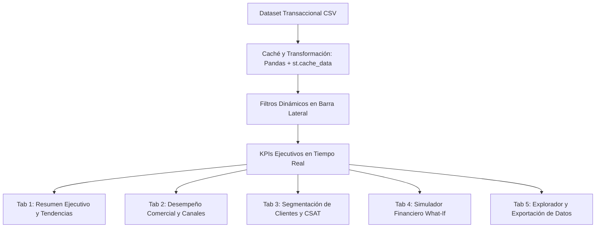

# Construyendo un Dashboard de Inteligencia de Negocios en Tiempo Real con Streamlit y Plotly: De Cero a Producción en la Nube

> **Autor:** Fabricio Rams  
> **Curso:** Inteligencia de Negocios (INT-Negocios 2026-II)  
> **Tags:** `Business Intelligence`, `Streamlit`, `Python`, `Data Visualization`, `Plotly`, `Cloud Deployment`, `CI/CD`  
> **Plataformas sugeridas para publicación:** Medium / Dev.to / Hashnode  

---

## 1. Introducción: La Era de la Toma de Decisiones Guiada por Datos

En el entorno corporativo contemporáneo, los datos son el activo más valioso de cualquier organización; sin embargo, **los datos crudos carecen de valor sin contexto e interpretabilidad**. La Inteligencia de Negocios (*Business Intelligence* o BI) tiene como propósito fundamental transformar grandes volúmenes de transacciones en conocimiento accionable, permitiendo a los líderes ejecutivos y directores de operaciones responder interrogantes críticas:

- ¿Cuáles son las líneas de negocio que generan el mayor margen operativo neto?
- ¿Cómo impactaría un incremento del 5% en los precios o una contracción del 10% en los costos operativos sobre nuestro EBITDA?
- ¿Qué segmentos de clientes concentran el mayor valor de ciclo de vida (*Customer Lifetime Value* - CLV)?

Tradicionalmente, la construcción de tableros de control ejecutivos dependía de herramientas propietarias pesadas (como Power BI, Tableau o Qlik) o de desarrollos web complejos basados en React, Angular y APIs en Django/FastAPI. Hoy en día, el ecosistema de Python ofrece una alternativa ágil, potente y de código abierto: **Streamlit combinada con Plotly**.

En este artículo, exploramos el desarrollo completo y despliegue automatizado de **OmniAnalytics BI**, un dashboard interactivo de nivel ejecutivo diseñado para monitorear ingresos, rentabilidad, cartera de productos y simulaciones de sensibilidad financiera (*What-If Analysis*).

---

## 2. Comparativa Tecnológica: ¿Por qué Streamlit frente a otras herramientas?

El ecosistema de visualización de datos en Python y R cuenta con diversas opciones con diferentes enfoques y curvas de aprendizaje:

| Herramienta | Tipo | Curva de Aprendizaje | Nivel de Interactividad | Despliegue en la Nube | Caso de Uso Ideal |
| :--- | :--- | :--- | :--- | :--- | :--- |
| **Streamlit** | Framework Web de Datos | **Muy Baja (Horas)** | **Alta (Reactiva)** | **Inmediato (Streamlit Cloud)** | Prototipos rápidos, tableros BI interactivos y apps de Machine Learning |
| **Plotly Dash** | Framework Web React/Flask | Media-Alta | Muy Alta (Control DOM total) | Requiere Docker / Heroku / AWS | Aplicaciones enterprise complejas con requerimientos de CSS/JS personalizados |
| **Shiny (R / Python)** | Framework Reactivo | Media | Alta | ShinyApps.io / Posit Connect | Entornos bioestadísticos, analítica actuarial e investigación académica |
| **Bokeh** | Biblioteca Gráfica | Media | Alta (En navegador) | Servidor Bokeh / Tornado | Visualizaciones de big data con streaming en tiempo real |
| **Seaborn / Matplotlib** | Biblioteca Estática | Baja | Nula / Muy Baja | Exportación a imágenes (PNG/PDF) | Informes estáticos, papers académicos y análisis exploratorio inicial |

### ¿Por qué elegimos Streamlit?
1. **Velocidad de desarrollo:** Permite convertir scripts analíticos de Python en aplicaciones web ricas y reactivas en minutos sin escribir una sola línea de HTML, JavaScript o endpoints REST.
2. **Ecosistema Integrado:** Soporte nativo para gráficos de alta definición con Plotly, DataFrames de Pandas, mapas y componentes de entrada (filtros, fechas, sliders).
3. **Mantenimiento y Despliegue SaaS:** Gracias a **Streamlit Community Cloud**, el despliegue es completamente automatizado mediante integración continua con GitHub: cada `git push` a la rama `main` actualiza la aplicación en producción de manera transparente.

---

## 3. Arquitectura y Modelado del Tablero: OmniAnalytics BI

El tablero fue diseñado bajo una arquitectura modular y de alto rendimiento, estructurada en cinco dimensiones clave:



### Principales Métricas Calculadas (KPIs)
- **Ventas Netas Totales:** Suma de ventas brutas menos descuentos comerciales aplicados.
- **Utilidad Operativa y Margen Neto:** Ganancia después de deducir el costo de bienes vendidos (COGS).
- **Volumen de Pedidos y Ticket Promedio (AOV):** Mide el tamaño medio de las transacciones.
- **Índice de Satisfacción del Cliente (CSAT):** Promedio de calificación (escala 1 a 5 estrellas).

---

## 4. Implementación Clave del Código

### 4.1. Optimización del Rendimiento con Caché
Para garantizar tiempos de respuesta ultrarrápidos, los datos se cargan y transforman utilizando el decorador `@st.cache_data`:

```python
import streamlit as st
import pandas as pd
import os

@st.cache_data
def load_data():
    file_path = os.path.join(os.path.dirname(__file__), 'data', 'retail_bi_dataset.csv')
    df = pd.read_csv(file_path)
    df['Fecha'] = pd.to_datetime(df['Fecha'])
    return df
```

### 4.2. Estilización Moderna con CSS Personalizado
Para lograr una apariencia premium, profesional y acorde a las tendencias de diseño (*dark theme & glassmorphism*), inyectamos estilos CSS personalizados:

```python
st.markdown("""
<style>
    @import url('https://fonts.googleapis.com/css2?family=Plus+Jakarta+Sans:wght@400;600;800&display=swap');
    html, body, [class*="css"] {
        font-family: 'Plus Jakarta Sans', sans-serif;
    }
    .metric-card {
        background: #1E293B;
        border: 1px solid rgba(255, 255, 255, 0.08);
        border-radius: 14px;
        padding: 20px;
        box-shadow: 0 4px 20px rgba(0, 0, 0, 0.25);
    }
    .metric-title { color: #94A3B8; font-size: 0.85rem; text-transform: uppercase; font-weight: 600; }
    .metric-value { color: #F8FAFC; font-size: 1.8rem; font-weight: 800; margin: 6px 0; }
</style>
""", unsafe_allow_html=True)
```

### 4.3. Simulador de Sensibilidad Financiera (Análisis "What-If")
Uno de los componentes más destacados para la toma de decisiones es el simulador interactivo donde la gerencia puede estimar variaciones en precios, volumen de ventas y costos:

```python
sim_col1, sim_col2, sim_col3 = st.columns(3)
with sim_col1:
    price_delta = st.slider("Ajuste en Precios (%):", -30, 30, 5, step=1)
with sim_col2:
    volume_delta = st.slider("Variación en Demanda (%):", -40, 50, 10, step=1)
with sim_col3:
    cost_delta = st.slider("Variación en Costos (%):", -20, 30, 3, step=1)

# Simulación en tiempo real
sim_sales = base_sales * (1 + price_delta/100) * (1 + volume_delta/100)
sim_cost = base_cost * (1 + cost_delta/100) * (1 + volume_delta/100)
sim_profit = sim_sales - sim_cost
```

---

## 5. Automatización y Despliegue en la Nube (CI/CD)

El proyecto cumple con los estándares modernos de desarrollo de software e ingeniería de datos:

1. **Control de Versiones:** Repositorio público alojado en GitHub en la rama principal `main`.
2. **Validación Continua (GitHub Actions):** Flujo de trabajo en `.github/workflows/ci.yml` que valida la sintaxis, dependencias e integridad del dataset en cada `push` o `pull request`.
3. **Despliegue Continuo (Streamlit Community Cloud):** 
   - Se vincula el repositorio de GitHub con [share.streamlit.io](https://share.streamlit.io).
   - El servicio SaaS detecta automáticamente el archivo `requirements.txt` y `app.py`.
   - Cada cambio enviado con `git push origin main` desencadena una reconstrucción automática del contenedor en la nube sin tiempo de inactividad.

---

## 6. Resultados y Lecciones Aprendidas

- **Agilidad:** Desarrollar un dashboard interactivo de nivel directivo tomó una fracción del tiempo que requeriría una arquitectura web convencional.
- **Interactividad Intuitiva:** La combinación de filtros multidimensionales y gráficos dinámicos con Plotly ofrece una experiencia de usuario fluida, permitiendo pasar de una vista general a una granular en segundos.
- **Democratización de Datos:** Desplegar en una plataforma SaaS pública permite a cualquier miembro del equipo acceder a la información desde cualquier navegador o dispositivo móvil.

---

## 7. Enlaces y Recursos

- 🔗 **Repositorio en GitHub:** [FabricioRams/AG-01-Visualization-Reports-or-Dashboard](https://github.com/FabricioRams/AG-01-Visualization-Reports-or-Dashboard)
- 🚀 **Aplicación Desplegada en Vivo:** [OmniAnalytics BI en Streamlit Cloud](https://share.streamlit.io/)
- 🎥 **Video Demostrativo (5 min):** [Ver en YouTube / Red Social](#)
