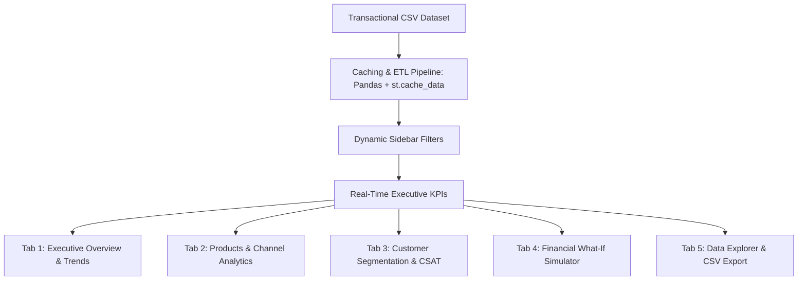

# OmniAnalytics BI: Executive Decision Support System Built with Streamlit and Plotly

## 1. Introduction: The Era of Data-Driven Decision Making

In the modern enterprise landscape, data is the most strategic asset of any organization; however, raw data lacks intrinsic value without context and interpretability. The primary objective of Business Intelligence (BI) is to transform transactional volumes into actionable intelligence, enabling executive leaders and operations directors to answer critical business questions:

- Which product categories and channels generate the highest net operating margin?
- How would a 5% price increase or a 10% operating cost contraction impact our EBITDA?
- Which customer segments yield the highest customer lifetime value (CLV) and purchase frequency?

Historically, developing executive control cockpits relied either on heavy proprietary software suites (such as Power BI, Tableau, or Qlik) or complex full-stack web applications built on React/Angular paired with Django/FastAPI microservices. Today, the Python data ecosystem provides an agile, robust, and open-source alternative: Streamlit combined with Plotly.

This article details the architectural design, implementation, and automated cloud deployment of OmniAnalytics BI—an interactive executive decision support dashboard engineered to monitor revenue streams, profitability margins, customer segmentation, and financial sensitivity simulations (What-If analysis).

---

## 2. Technology Benchmark: Why Streamlit Over Other BI Tools?

The Python and R data visualization ecosystems offer several mature frameworks, each serving distinct operational requirements:

| Tool | Category | Learning Curve | Interactivity Level | Cloud Deployment | Ideal Use Case |
| :--- | :--- | :--- | :--- | :--- | :--- |
| **Streamlit** | Data Web Framework | Very Low (Hours) | High (Reactive State) | Instant (Streamlit Cloud) | Rapid prototyping, interactive executive BI dashboards, and ML applications |
| **Plotly Dash** | React / Flask Framework | Medium to High | Very High (Full DOM Control) | Requires Docker / AWS / Heroku | Complex enterprise applications requiring bespoke CSS and JavaScript hooks |
| **Shiny (R / Python)** | Reactive Web Framework | Medium | High | ShinyApps.io / Posit Connect | Biostatistics, actuarial modeling, and academic scientific research |
| **Bokeh** | Browser Graphics Library | Medium | High (In-Browser Canvas) | Bokeh Server / Tornado | Streaming architectures and real-time big data canvases |
| **Seaborn / Matplotlib** | Static Plotting Library | Low | None / Minimal | Static Export (PNG/PDF/SVG) | Exploratory data analysis, static reports, and academic research papers |

### Strategic Reasons for Choosing Streamlit

1. **Development Velocity:** Transforms analytical Python routines into responsive web applications within minutes, without writing HTML, JavaScript, or custom REST endpoints.
2. **Native Plotly Integration:** Provides seamless rendering of hardware-accelerated interactive charts, Pandas DataFrames, and UI input controllers (date pickers, multidimensional multi-selects, sliders).
3. **Automated Cloud SaaS Deployment:** Through Streamlit Community Cloud, continuous deployment is native: every `git push` to the `main` branch automatically deploys an updated production container with zero downtime.

---

## 3. Architecture and Dashboard Modeling: OmniAnalytics BI

The application follows a modular, high-throughput analytical architecture structured across five core analytical dimensions:



### Core Business Metrics (KPIs)

- **Net Sales:** Gross transactional revenue net of promotional discounts.
- **Operating Profit & Margin:** Net gain after subtracting Cost of Goods Sold (COGS).
- **Order Volume & Average Order Value (AOV):** Transaction volume and average basket size per checkout.
- **Customer Satisfaction Score (CSAT):** Weighted customer sentiment score on a 1.0 to 5.0 scale.

---

## 4. Key Implementation Highlights

### 4.1. High-Performance In-Memory Data Caching

To guarantee sub-second interaction across large datasets, ingestion and datetime transformations are memoized using `@st.cache_data`:

```python
import streamlit as st
import pandas as pd
import os

@st.cache_data
def load_data():
    file_path = os.path.join(os.path.dirname(__file__), 'data', 'retail_bi_dataset.csv')
    df = pd.read_csv(file_path)
    df['Fecha'] = pd.to_datetime(df['Fecha'])
    return df
```

### 4.2. Modern UI & Glassmorphism Design System

A customized CSS layer is injected directly into the application DOM, applying the modern Plus Jakarta Sans typography and glassmorphic card containers:

```python
st.markdown("""
<style>
    @import url('https://fonts.googleapis.com/css2?family=Plus+Jakarta+Sans:wght@400;600;800&display=swap');
    html, body, [class*="css"] {
        font-family: 'Plus Jakarta Sans', sans-serif;
    }
    .metric-card {
        background: #1E293B;
        border: 1px solid rgba(255, 255, 255, 0.08);
        border-radius: 14px;
        padding: 20px;
        box-shadow: 0 4px 20px rgba(0, 0, 0, 0.25);
    }
    .metric-title { color: #94A3B8; font-size: 0.85rem; text-transform: uppercase; font-weight: 600; }
    .metric-value { color: #F8FAFC; font-size: 1.8rem; font-weight: 800; margin: 6px 0; }
</style>
""", unsafe_allow_html=True)
```

### 4.3. Financial Sensitivity Modeling ("What-If" Analysis)

A real-time financial simulation engine empowers decision-makers to stress-test unit economics against pricing fluctuations, demand elasticity, and cost inflation:

```python
sim_col1, sim_col2, sim_col3 = st.columns(3)
with sim_col1:
    price_delta = st.slider("Price Adjustment (%):", -30, 30, 5, step=1)
with sim_col2:
    volume_delta = st.slider("Demand Fluctuation (%):", -40, 50, 10, step=1)
with sim_col3:
    cost_delta = st.slider("Cost Fluctuation (%):", -20, 30, 3, step=1)

# Real-time simulation computations
sim_sales = base_sales * (1 + price_delta / 100) * (1 + volume_delta / 100)
sim_cost = base_cost * (1 + cost_delta / 100) * (1 + volume_delta / 100)
sim_profit = sim_sales - sim_cost
```

---

## 5. Automated CI/CD and Cloud Deployment

The repository adheres to contemporary software engineering and data governance standards:

1. **Source Version Control:** Clean git commit history on the default `main` branch.
2. **Automated Continuous Integration (GitHub Actions):** Workflows defined in `.github/workflows/ci.yml` validate dependency resolution, code syntax, and dataset schema on every `push` and `pull_request`.
3. **Continuous Deployment (Streamlit Community Cloud):**
   - The GitHub repository connects directly to Streamlit Community Cloud.
   - The platform parses `requirements.txt` and runs `app.py`.
   - Every `git push origin main` triggers an automated container rebuild and redeployment without service interruption.

---

## 6. Results and Key Takeaways

- **Agility:** Building an interactive, enterprise-grade decision support system was completed in hours compared to weeks with traditional web stacks.
- **Fluid User Experience:** Combining multi-axis dynamic filtering with Plotly provides seamless exploration from high-level portfolio KPIs down to individual transactions.
- **Democratized Insights:** Cloud deployment enables cross-functional teams to access real-time dashboards securely from any modern browser or mobile device.

---

## 7. Links and Resources

- **GitHub Repository:** [FabricioRams/AG-01-Visualization-Reports-or-Dashboard](https://github.com/FabricioRams/AG-01-Visualization-Reports-or-Dashboard)
- **Live Cloud Dashboard:** [OmniAnalytics BI on Streamlit Cloud](https://omnianalytics-bi.streamlit.app/)
- **Demonstration Video:** [Watch on YouTube / Media Platform](#)
